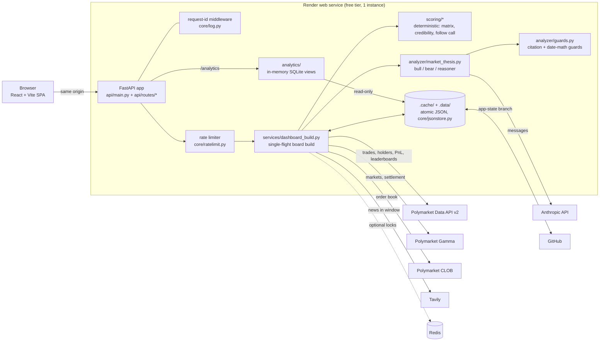
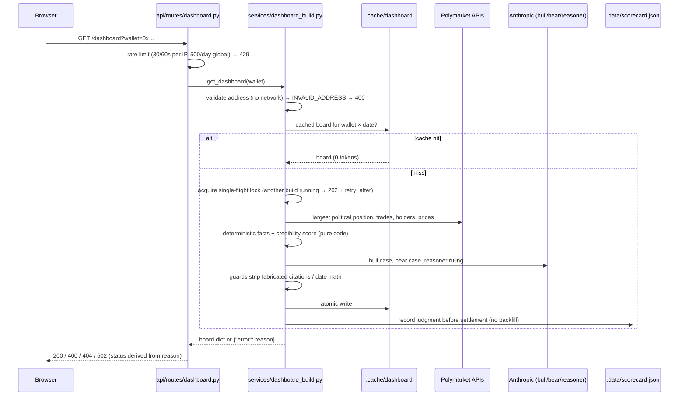

# Architecture

Smart Money Decoder is one FastAPI process that serves a React/Vite single-page app and a
JSON API from the same origin, deployed as a single free-tier Render web service. There is
no database server: state lives in atomic JSON files, restored on cold start from git and
from a GitHub branch, and read into SQL on demand for analytics.

## System view

## Request path: `GET /dashboard?wallet=0x…`

## Layers and the rules between them

| Layer | Directory | Rule |
|---|---|---|
| HTTP assembly | `api/main.py`, `api/routes/` | Only maps reasons to status codes. Importing `api.main` has no side effects, so tests can use `TestClient` without keys. |
| Service | `services/dashboard_build.py` | Returns dicts, never raises on expected failures, never imports the API layer. |
| Deterministic scoring | `scoring/` | Pure functions; every threshold lives in `scoring/constants.py`. Same facts in, byte-identical output. |
| AI | `analyzer/`, `briefing/` | All model calls go through `core/llm.py`. Output is labelled `deterministic: false`. |
| Data access | `fetcher/` | `fetcher/pm_backend.py` maps Polymarket's public APIs to one record shape; `DATA_BACKEND` switches providers. |
| Infra | `core/` | Logging with request ids, health report, rate limiter, Redis coordination, atomic JSON store, GitHub persistence. |
| Analytics | `analytics/` | Read-only SQL projection of `.data/`; never writes the archives. |

## State and persistence

| State | Where | Survives a Render redeploy? |
|---|---|---|
| Board / briefing / reasoner caches | `.cache/` | Restored from git-tracked `seed/cache`, then overlaid with the newer `app-state` bundle if `GITHUB_TOKEN` is set |
| Judgment archive, recommendations, hot traders | `.data/` | Same as above (`seed/data` + `app-state`) |
| Confidence log (`confidence_log.jsonl`) | `.data/` | Reset to the seed copy on cold start (known gap P2-27; only pending readings can be lost, never settled facts) |
| Locks / job status | in-process, or Redis if `REDIS_URL` set | No, by design |

Every JSON write is atomic (temp file + rename). A file that fails to parse is moved aside
as `.corrupt-*` and never silently overwritten (`core/jsonstore.py`).

## Analytics (SQL)

`GET /analytics` loads the four archives into an in-memory SQLite database
(`analytics/schema.sql`: `judgments`, `confidence_readings`, `recommendations`,
`hot_traders`), applies `analytics/views.sql`, and returns each view. The database is rebuilt
per request (about 5 ms locally at the current archive size), so it can never drift from
the archives. The same SQL runs on PostgreSQL 16 in CI. The test that keeps it honest:
the SQL scorecard must equal `scorecard.compute_scorecard()` on the real archive.

## What is deliberately not here

- **No auth.** The product is open; the only credit-spending route is rate-limited instead.
- **No database server.** Single instance, small data, ephemeral disk; JSON + git restore
  is cheaper to run than a managed DB. The SQL layer is a projection so the relational
  model exists without a second source of truth.
- **No background workers.** Long rebuilds run in-process with stale-while-revalidate.
